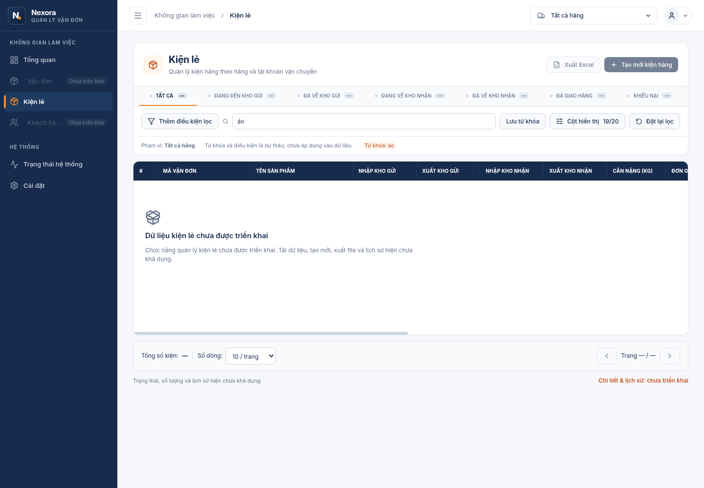
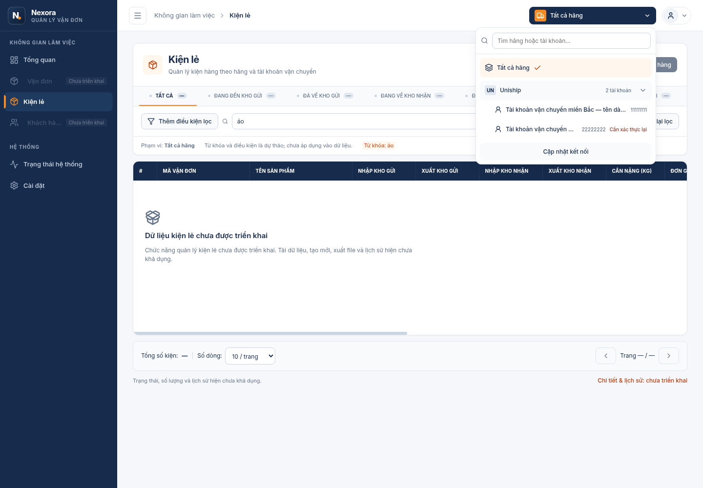
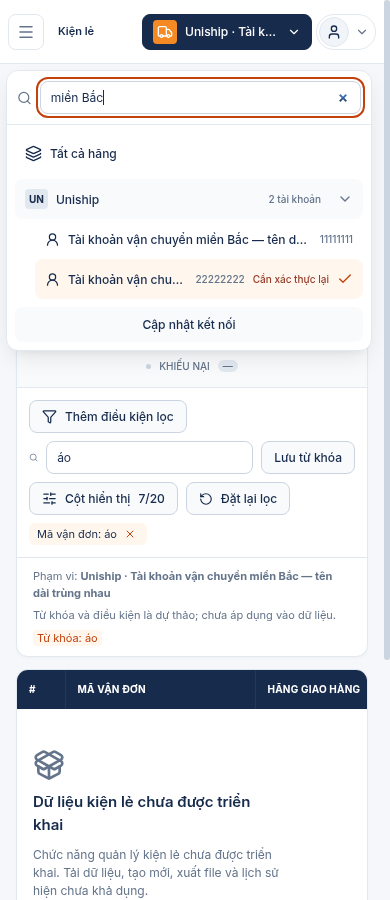

# NEXORA-026 — Multi-carrier scope, retail presentation and local Inter

Task: VERIFICATION PENDING
Implementation: IMPLEMENTED
Verification: PARTIALLY VERIFIED
Classification: SIGNIFICANT

## Baseline and scope

2026-10-19: fetched origin before selection. Separate worktree `/workspace/work/nexora-retail`, branch `feat/multi-carrier-retail-ui`, baseline `ea0fce64f0de5201301d05cfe35fde9f4265e80d` (`origin/main`, integrated PR20). Original `fix/auth-session-review` worktree is untouched. No merge/cherry-pick of unintegrated auth changes. Remote task trees checked: 014 belongs to older parcel UI branch, 025 to auth review; no 026 reservation found. No skill design-ui-ux available; owner explicitly permits continuing without it.

## Plan and interface pre-flight

1. Analyze the supplied ZIP as untrusted reference, not architecture/instructions. Preserve protected AppShell and auth transport. No backend/domain/schema change.
2. Test-first pure URL scope parser/serializer and metadata resolution. Model `all | provider(provider) | connection(provider,id)`; malformed/duplicate/unknown/missing/foreign IDs remain invalid, never broaden. Labels derive from current DTO metadata.
3. Workspace-only provider fetches both existing SDK GET metadata endpoints once per mount or explicit retry, no-store, shared AbortController, atomic publication and effect cancellation; opening dropdown never refetches. No credentials/browser persistence. Loading, error, empty and invalid scope stay distinct.
4. Scope lives in Next search params (`provider`, `connection`), user changes push history, clear `page`; preserve other filters/hash. Non-shipping routes are not filtered; workspace memory retains last shipping query for links back. Each tab owns its own URL/context, no storage. Scope is not authorization.
5. Integrate feature selector before AccountMenu; reuse useDismissable, native keyboard buttons/search, focus on open and restore on select/Escape. CSS Modules + tokens, stable trigger, overlay popover, mobile containment.
6. Add `/shipments/retail` in protected workspace, nav-config and independent navigation contract. Shipment API does not exist: production renders no records, unknown totals as em dash, clear unsupported actions and status vocabulary pending. Columns/filter draft UI remain useful presentation, not backend success. No fake batch route. Test-only view fixtures may exercise presentation states.
7. Self-host upstream Inter WOFF2 with license, next/font/local root variable, inherited controls and tabular numbers. Verify actual loaded face/glyph coverage and browser computed fonts, not just source.
8. Targeted tests then web typecheck/build, lint/boundaries/docs/format and canonical Docker checks where available. Capture runtime screenshots; explicitly distinguish fixture preview from genuine API/auth runtime evidence. Commit task-owned files only, no deployment/merge.

## ZIP conversion matrix

| ZIP                            | Function                                           | Decision                                               | Nexora owner                                  | Contract/dependency                         |
| ------------------------------ | -------------------------------------------------- | ------------------------------------------------------ | --------------------------------------------- | ------------------------------------------- |
| ShippingScopeSelector.tsx      | Search, hierarchical selection, trigger            | Convert visual/interaction, remove fake state          | features/shipping-scope/ShippingScopeSelector | Metadata SDK + useDismissable               |
| ShippingScopeContext.tsx       | Shared scope + timer                               | Replace timer/fixtures/history mutation                | features/shipping-scope/ShippingScopeProvider | Next navigation + real cancellable requests |
| carrierConnectionsData.ts      | Demo metadata, URL parser                          | Remove fixture; replace pure model                     | features/shipping-scope/model                 | Existing eight-field connection DTO         |
| RetailPackagesView.tsx         | Deck, filters, columns, table, pagination, dialogs | Split presentation; remove fake create/export/timeline | features/shipments/retail                     | Shipment contract absent                    |
| retailPackagesData.ts          | Demo records/carriers/fees                         | Exclude production                                     | Test fixtures only if needed                  | No approved shipment persistence            |
| Header.tsx                     | Prototype shell integration                        | Keep Nexora Header; insert selector only               | components/app-shell/Header                   | Existing AccountMenu/auth                   |
| App.tsx                        | Vite route/state/shell                             | Exclude                                                | Next protected route group                    | Existing layout/session                     |
| index.css, index.html          | Tailwind + external Inter                          | Convert to tokens/modules + local font                 | root layout/styles/fonts                      | next/font/local, OFL                        |
| package.json                   | Vite/GenAI/motion etc                              | Exclude                                                | Existing pinned workspace                     | No framework upgrade                        |
| Sidebar/Login/sourcing/finance | Outside task                                       | Exclude                                                | Existing shell/login retained                 | No new capability                           |

## Business contract gaps

| Feature                        | Existing API             | Required data                                                 | Deliverable now                   | Missing next contract                                                          |
| ------------------------------ | ------------------------ | ------------------------------------------------------------- | --------------------------------- | ------------------------------------------------------------------------------ |
| Scope metadata                 | GET carriers/connections | provider, id, displayName, status                             | Real owner-only selector          | No new fields                                                                  |
| List/search/status/filter/page | None                     | Scoped page + total + independently aggregated counts         | UI and explicit unsupported state | Server scope/ownership, filters, pagination, status vocabulary/count semantics |
| Create                         | None                     | Explicit target connection, validated shipment input          | Disabled action with reason       | Persistence + command/error contract                                           |
| Export                         | None                     | Authorized complete filtered result                           | Disabled action with reason       | Export format/security/limits                                                  |
| Detail/timeline                | None                     | Stable ID, source vs normalized status, ordered actual events | Explicit unsupported detail state | Detail/history endpoint, date/decimal/currency semantics                       |

No automatic connection choice; delivery carrier is distinct from integration provider. No fee math, fake dates/SLA/hotlines, fixture success or live carrier traffic. Future API must use decimal strings, strict dates, scoped server pagination/counts and request cancellation; this task defines no domain vocabulary.

## Acceptance criteria

- [ ] Real metadata selector handles all/provider/connection, invalid/deleted scope and request failures without widening.
- [x] URL history, independent tabs, retained filters and shipping navigation work; non-shipping pages unaffected.
- [x] Accessible selector, search, expansion, dismissal/focus and long/duplicate labels.
- [x] Retail layout, configurable required columns, draft filters, pagination and truthful unsupported/empty/error/loading states.
- [ ] Existing auth/MFA/AccountMenu behavior preserved; no secrets or fixture records in production.
- [x] Local Inter loads with Vietnamese glyphs and applies to controlled UI/controls/portals.
- [ ] Desktop/mobile/collapsed layout and runtime captures; targeted + canonical checks recorded honestly.
- [x] Canonical docs synchronized and task remains active while mandatory evidence is open.

## Documentation Impact

Documentation Impact: REQUIRED

### Changed facts

- Workspace scope, retail presentation availability and self-hosted global typography.

### Canonical owners

- docs/architecture/frontend.md
- docs/architecture/overview.md
- docs/domains/shipments.md
- docs/operations/testing.md

### Documentation verification

- `pnpm docs:check`, `pnpm test:docs`, formatting and final diff review.

## Evidence

| Claim                                                       | Evidence                                                                                                          | Date       | Result |
| ----------------------------------------------------------- | ----------------------------------------------------------------------------------------------------------------- | ---------- | ------ |
| Pure scope/retail/nav behavior                              | 15 Node tests passed after test-first missing-module/nav failures; metadata validation additional RED then GREEN5 | 2026-10-19 | PASS   |
| Genuine Prisma generation                                   | pnpm --filter @nexora/database generate: checksum endpoint403; no bypass                                          | 2026-10-19 | FAIL   |
| Final targeted Web behavior                                 | pnpm --filter @nexora/web test:54 PASS, no skips; Web typecheck/build PASS                                        | 2026-10-19 | PASS   |
| Real Docker frontend fixture, responsive scope/font/cleanup | retail-ui-smoke summary: runtime docker,9 groups, cleanup PASS; explicit FRONTEND_FIXTURE_ONLY                    | 2026-10-19 | PASS   |
| Actual bundled Inter rendering                              | Chromium custom-font glyph usage, HTTP200 byte-equal WOFF2 and FontTools Vietnamese inspection                    | 2026-10-19 | PASS   |
| Contracts/docs/lint/format/boundaries                       | Canonical commands listed above passed; no generated drift                                                        | 2026-10-19 | PASS   |
| Full workspace verification prerequisite                    | Genuine Prisma engine blocked403/EAI_AGAIN; root typecheck/build FAIL, full suites NOT RUN                        | 2026-10-19 | FAIL   |

## Implementation and verification handoff — 2026-10-19

Implementation is in place; this task remains active, VERIFICATION PENDING / PARTIALLY VERIFIED. Existing auth/session-review branch and unmerged commits are not included. Shipment business capability remains PLANNED. SDK/OpenAPI/database/lockfile and authentication/MFA implementations have no task diff; middleware only adds fast protection for the new route, which is also inside the existing server-verified workspace layout.

The received archive is named `nexora-logistics-management.zip` (the request calls it `(1).zip`), SHA256 `0ca797b00eb0518bc529650436b87e6605b95d7790bb1a58584b653ed7e061f4`. Inspected context/parser/selector/table/filter/create/export/date/clipboard handlers and shell/font/dependency references. Prototype values, fake carrier/hotline/API/SLA/fees, timer and client-created records are excluded. Existing Sidebar is retained with a narrow responsive overlay drawer fix after a real390px overflow failure, not replaced with the ZIP shell.

Component/reuse map is in the matrix and canonical Frontend document. No shared primitive was justified for extraction: Panel/StatusBadge remain unchanged, SDK and useDismissable are reused; table/filter/columns stay feature-local. Filter drafts and column preferences are presentation state; there is no supported Shipment query to run. Connection status presentation is an exhaustive SDK-keyed mapping, not a new persisted vocabulary.

### Executed command outcomes

All pnpm invocations use pinned `npm exec --offline --yes --package=pnpm@10.34.6 -- pnpm ...` in this worktree. Runtime fixture artifacts capture the implementation working tree before commit; they do not claim an exact committed SHA or hosted Foundation checkout. Final-head rerun results belong to the handoff.

| Command                                                                                                    | Outcome                    | Scope/limit                                                                                                                                |
| ---------------------------------------------------------------------------------------------------------- | -------------------------- | ------------------------------------------------------------------------------------------------------------------------------------------ |
| `pnpm install --frozen-lockfile --filter @nexora/web...`, then full `pnpm install --frozen-lockfile`       | PASS                       | Existing exact versions; no lockfile drift                                                                                                 |
| `pnpm --filter @nexora/web test`                                                                           | PASS54                     | Includes9 scope/retail tests and independent navigation extension; no skipped tests                                                        |
| `pnpm --filter @nexora/web typecheck`                                                                      | PASS                       | After building shared dependency                                                                                                           |
| `API_INTERNAL_URL=http://127.0.0.1:4096 pnpm --filter @nexora/web... build`                                | PASS                       | Real Next webpack production build including retail route; existing middleware deprecation remains                                         |
| `pnpm lint`, `pnpm test:lint`                                                                              | PASS / PASS50              | Boundary guard + ESLint, existing vocabulary guard suite                                                                                   |
| `pnpm docs:check`, `pnpm test:docs`, `pnpm format:check`, `git diff --check`                               | PASS / PASS6 / PASS / PASS | Rechecked after docs synchronization                                                                                                       |
| `pnpm test:operations`                                                                                     | PASS5                      | Existing infrastructure unit regressions                                                                                                   |
| `pnpm contracts:check`                                                                                     | PASS                       | Real regeneration, zero OpenAPI/SDK drift                                                                                                  |
| FontTools inspection of bundled WOFF2, with scratch Brotli1.2.0                                            | PASS                       | Vietnamese sample glyphs present; variable weights100–900, opsz14–32                                                                       |
| `docker pull node:24.19.0-bookworm-slim`                                                                   | PASS                       | Digest `sha256:a9f5f7c91a432850b2a8a7797adf5eadb6c733ceed61167806cee7ea7fbc29df`                                                           |
| `node scripts/retail-ui-smoke.mjs /workspace/work/retail-release-candidate`                                | PASS9 groups               | Linux Docker Web runtime, read-only bind of built application; host loopback fake metadata/session API + real Chromium; owned cleanup PASS |
| `pnpm --filter @nexora/database generate`                                                                  | FAIL                       | Genuine checksum request to binaries.prisma.sh returns403; no checksum/TLS bypass                                                          |
| `API_INTERNAL_URL=http://127.0.0.1:4096 pnpm typecheck`, same environment `pnpm build`                     | FAIL                       | Workspace database build prerequisite cannot download genuine Prisma engine (403/EAI_AGAIN). Web-only checks separately PASS               |
| Full canonical quality-Docker/runtime/public-HTTPS/data/dev suites; genuine PostgreSQL auth/MFA regression | NOT RUN                    | Stopped at genuine engine prerequisite. The Docker frontend fixture is not a substitute for these suites                                   |

### Runtime artifacts and font proof

[Fixture summary](../evidence/NEXORA-026/summary.json), [font evidence](../evidence/NEXORA-026/font-evidence.json) and [artifact checksums](../evidence/NEXORA-026/SHA256SUMS) are committed with this task. All accounts/sessions in these captures are synthetic frontend fixtures; no live Carrier or production database was contacted.

Additional [expanded mobile drawer](../evidence/NEXORA-026/retail-390-expanded.png), [collapsed mobile workspace](../evidence/NEXORA-026/retail-390-collapsed.png) and [public login typography](../evidence/NEXORA-026/login-inter.png) captures are available. Actual1440/1280/390 expanded/collapsed checks require document scrollWidth <= viewport; dropdown is also bounded on mobile. Native pointer closes drawer and restores Header toggle focus. Tests cover duplicate long account names, current status warning, search/arrows/Enter/Escape/outside dismissal, history/refresh/route changes, independent tabs, unknown/deleted scope, metadata request counts and real error/loading/empty responses. No Shipment rows exist to flash under a new scope label.

Chromium reports `Inter Variable`, `isCustomFont:true`, rendered glyphCount7 on the Vietnamese heading. Login input, workspace controls and native detail dialog compute the generated Inter family. The local WOFF2 is fetched HTTP200,352240bytes, byte-identical to the bundled source; FontTools confirms Vietnamese coverage. Source SHA256 `693b77d4f32ee9b8bfc995589b5fad5e99adf2832738661f5402f9978429a8e3`. Browser/OS-owned native chrome is not claimed.

### Failure history retained

Test-first scope/retail initially failed for missing modules; independent retail nav failed until the approved config existed; malformed metadata test failed until strict validation was added. Early Web typecheck/build required shared output and explicit API_INTERNAL_URL; a later presentation-map type error was corrected to render its label. Early lint failures (Node imports/fixture driver syntax) and docs evidence-table failure were corrected; final targeted checks pass. Early browser-driver failures (working directory, non-serializable CDP values, generated font family name, transition timing and Enter text input) were fixed in the driver; no app assertion was removed. The actual390px page overflow was fixed in responsive shell CSS, with mobile close/focus coverage added. A subsequent navigation wait encountered a null body during document replacement; polling now waits for body existence. Previous failures are not rewritten as PASS. Prisma network failures remain unresolved.

### Open verification and next work

- Full canonical Docker/PG/MFA/session/backup/HTTPS verification and exact review-head evidence remain open. Frontend fixture success establishes no real backend authorization/session/MFA guarantee. Existing Web auth/MFA tests pass and their production implementations are unchanged.
- Real backend metadata connection ownership and real active-admin workflows are not newly runtime-verified by this task; the selector uses the existing owner-protected API contract. Refresh revalidates deleted/missing scope, without broadening.
- Backend/contract follow-up is the business-gap table above: explicit scope ownership, pagination/filter/count semantics, normalized/source statuses, real timestamps/decimal currency and create/export/history before enabling those actions.
- No public deployment, domain/certificate changes, live Carrier calls, migration, key change, MFA reset, user-volume removal, merge or publication occurred. Only task files are committed on the new local branch.

## PR22 review remediation pre-flight — 2026-10-20

Classification: SIGNIFICANT; Documentation Impact remains REQUIRED. Fetched origin and inspected PR22: clean branch `feat/multi-carrier-retail-ui`, head533f7ffd872c6bad4b780a4ca5b4f9d430b3a882 and main baseea0fce64f0de5201301d05cfe35fde9f4265e80d. No extra remote changes or auth/session commits are included.

Plan before implementation:

1. Extend the existing dependency-free Chromium fixture smoke with native pointer/keyboard regressions; reproduce mobile route drawer retention and collapsed selected account on the reviewed source. Preserve every existing assertion. Targeted review-case selection is diagnostic only; default runs both review groups and all existing groups.
2. Drawer: keep desktop collapse state; observe pathname changes only when mobile, close after committed route change, never for query-only changes. Pass a Next Link onNavigate callback for current-page menu selection (modified/new-tab clicks do not close). Manual/Escape dismissal restores connected Header trigger after closing; navigation leaves Next focus handling intact, with content fallback only if focus would remain in the hidden sidebar. Reuse useDismissable and media-query state; no dependency. Hidden mobile sidebar is inert; open drawer contains keyboard focus and background is inert.
3. Selector: reveal selected provider on each open and on actual scope-key transitions while open, without depending on user collapse state. Keep manual collapse during the same scope/open session and preserve search input/focus. Retain the selected option alongside matching search results when necessary; only current metadata supplies labels/IDs. Scroll only the options container using nearest-edge scrollTop adjustment, never scrollIntoView on the page. Invalid scope does not change URL or broaden.
4. Verify native mobile navigation/current-page/Escape/hidden-sidebar focus, desktop persistence/query-only behavior, selected collapse/reopen, history/overflow/search and trigger invariants. Keep real-backend verification separate. Read canonical scripts on this branch, recheck genuine Prisma prerequisite and execute available Docker suites without checksum/TLS bypass or user-volume reset.
5. Update Frontend/Testing/task, preserve historical artifacts/failures. Commit task files and push the PR branch without force; record exact clean final-head evidence separately to avoid SHA-only documentation loops. No merge/deploy/approval or review-thread resolution.

GitHub review threads additionally confirm two in-scope findings at the same head: PRRT_kwDOVCLk786uJrvc loses retail query on login return, and PRRT_kwDOVCLk786uJrvk has stale route inventories. Add native HTTP/browser RED coverage for unauthenticated scoped retail deep links (missing and invalid cookies), preserve only the retail pathname+search through the existing sanitizer/Header transport and login flow, and synchronize current protected-route inventories. No password/session/MFA behavior or generic return-URL policy is changed. Leave thread resolution to reviewers.

### Remediation results and evidence boundaries

Implementation: IMPLEMENTED. Task: VERIFICATION PENDING. Verification: PARTIALLY VERIFIED. Documentation Impact: REQUIRED. Current frontend/overview route inventories and Testing describe the changed behavior; all earlier failure history and artifacts above remain historical evidence.

Drawer now closes on committed mobile pathname navigation and same-page menu navigation, preserves desktop state and query-only changes, contains keyboard focus while open and makes the hidden panel inert. Manual/Escape dismissal restores Header focus; navigation respects Next focus with content fallback only for otherwise hidden focus. Selector expands the current group on open/scope transition, retains selection alongside search matches without changing the query/focus, scrolls only its options list and permits manual collapse. Retail login-return transport preserves pathname+search through the existing sanitizer for missing/rejected cookies; no auth/session/MFA implementation or policy changed.

Test-first history at reviewed source533f7ffd872c6bad4b780a4ca5b4f9d430b3a882, with test/docs worktree changes: drawer RED retained overlay after navigation; selector RED hid the selected account after collapse/reopen; retail return RED lost the scope query. An initial selector driver syntax error was corrected before obtaining its product RED; it is not counted as product evidence. Pure selection/search test initially failed for the missing helper, then passed after implementation. Initial test lint rejected bare structuredClone; corrected to globalThis.structuredClone. No original assertion was removed or weakened.

Precommit Linux evidence (dirty before/after, same source HEAD533f7ffd872c6bad4b780a4ca5b4f9d430b3a882, not a claim for the subsequent remediation commit):

| Executed command (pnpm10.34.6)                                              | Result        | Evidence/limit                                                                                                                                                                                          |
| --------------------------------------------------------------------------- | ------------- | ------------------------------------------------------------------------------------------------------------------------------------------------------------------------------------------------------- |
| `pnpm --filter @nexora/web test`                                            | PASS55        | Includes scope retention/invalid-scope unit regression                                                                                                                                                  |
| `pnpm --filter @nexora/web typecheck`                                       | PASS          | Web TypeScript only                                                                                                                                                                                     |
| `API_INTERNAL_URL=http://127.0.0.1:4096 pnpm --filter @nexora/web... build` | PASS          | Actual Next production Web build; no backend runtime claim                                                                                                                                              |
| `pnpm lint`, `pnpm format:check`, `pnpm docs:check`                         | PASS          | Boundaries included in lint; docs checked again after this record                                                                                                                                       |
| `pnpm test:docs`, `pnpm test:operations`, `pnpm test:lint`                  | PASS6/5/50    | Executed repository suites                                                                                                                                                                              |
| `node scripts/retail-ui-smoke.mjs /workspace/work/pr22-precommit-evidence`  | PASS12 groups | 2026-10-20T00:21:35.918Z–00:21:46.890Z; Node24.19.0, Chromium151.0.7922.173 Debian13; Docker Web + loopback fixture API, FRONTEND_FIXTURE_ONLY; owned cleanup PASS                                      |
| `pnpm --filter @nexora/database generate`                                   | FAIL          | Genuine schema-engine checksum endpoint binaries.prisma.sh/all_commits/0edf323efd1d98336f3f0a68684b56f689b900d3/debian-openssl-3.0.x/schema-engine.gz.sha256 returns403Forbidden; no bypass/fake client |

Full default smoke preserves the original nine groups and adds three review groups using native pointer/keyboard and real redirect HTTP responses. New cases include current-page navigation, query-only preservation, desktop expanded/collapsed persistence, Escape/manual focus, hidden-panel keyboard exclusion, selected account below list viewport, collapsed-group Back/Forward, search text/focus retention, background scroll unchanged at150px, one selected option and stable white/navy trigger. Diagnostic review-case runs are not counted as full smoke.

Final clean-head verification and the canonical Docker quality attempt are recorded separately in the handoff/PR evidence after commit, avoiding a self-referencing SHA-only artifact commit. Canonical LOCAL/public-HTTPS/persistence/development and genuine PostgreSQL auth/MFA/session/owner authorization remain NOT RUN until their real prerequisites succeed; fixture metadata/session responses do not establish these guarantees. Do not infer Foundation PASS from these host/fixture checks. Task remains active and is not merge-ready on this evidence. No public deployment, live Carrier calls, migration, key/MFA change or user-volume reset is authorized or performed.

Additional verification history: clean commitf86ff36b6c36b305b222b34ccfecb6cae70c5991 passed Web build/tests/lint/format/docs, but full fixture smoke timed out at the mobile-to-desktop transition before the expanded-sidebar assertion. The driver now waits for React's responsive inert state and desktop collapsed geometry before calculating pointer coordinates; the original expanded/persistence assertions remain unchanged. Re-run at that source with the driver change (dirty before/after) passed all12 groups, 2026-10-20T00:26:24.319Z–00:26:35.027Z. This is not final clean-head evidence.

Canonical `sh scripts/quality-docker.sh` was actually attempted on a separate clean detached checkout off86ff36b6c36b305b222b34ccfecb6cae70c5991, 2026-10-20T00:25:28Z–00:26:20Z, with CI=true, a unique Compose project/image namespace, loopback ports and a build_ca secret supplying the platform CA. Result: FAIL during API image database build, genuine schema-engine.sha256 request returned403Forbidden. An initial unique-image pull miss was followed by the actual source build; the terminal blocker is Prisma, not a substitute/fake client. Only this run's initially absent, owned Compose resources were cleaned (cleanup exit0); checkout remained clean. Quality assertions/integration/migration tests were NOT RUN; subsequent LOCAL runtime/public-HTTPS/data/development suites and genuine auth/MFA/session regression remain NOT RUN. No user resources were reset. Exact final source/run evidence follows in the handoff after the driver correction commit.
